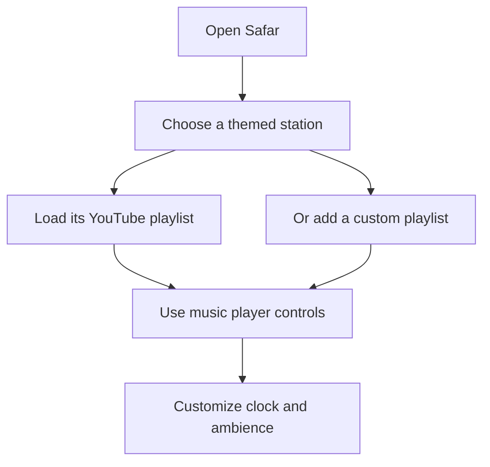

📻 SAFAR — NOSTALGIC MUSIC APP
Not just music. A journey through memories.
An atmospheric, retro-inspired music experience built for long roads, rainy evenings, and timeless playlists.

🎵 Explore the Code · 🐛 Report an Issue · 💡 Suggest a Feature

✨ What is Safar?
Safar (meaning journey) is an immersive, nostalgia-themed music player that combines themed playlists, atmospheric visuals, ambient sounds, and YouTube-powered playback.

Instead of a conventional playlist screen, Safar lets you step into memorable settings—from a bus driver's music-filled journey to a neighborhood salon or a truck driver's highway ride.
🌧️ Put on your headphones, switch on the rain, pour some virtual chai, and let the journey begin.

🧭 Quick Navigation
- Experience the Worlds
- Features
- Technology Stack
- Getting Started
- Keyboard Shortcuts
- How It Works
- Contributing
- Developer
🎞️ App Preview
<!-- Replace the line below with an actual app screenshot or GIF when ready. -->📸 Preview coming soon. Add an image at assets/safar-preview.png, then replace this note with:

🛣️ Experience the Worlds
🎙️ Station	🌆 Atmosphere	🎵 Experience
🚌 Bus Driver	Roads, memories, and everyday journeys	A nostalgic bus-ride soundtrack
💈 Deluxe Salon	The charm of an old-school neighborhood salon	Salon-inspired retro listening
🚛 Truck Driver	Open highways and late-night travel	A road-trip listening experience
➕ Custom Playlist	Your choice	Load a supported YouTube playlist

🚀 Features
Feature	What it does
🎧 YouTube playlist playback	Play music from themed YouTube playlists through the app.
🎛️ Music controls	Play/pause, navigate tracks, seek, and adjust sound.
🌧️ Ambient rain	Toggle rainy atmosphere to complement your music.
📻 Themed stations	Switch between distinct visual and musical experiences.
🕰️ Customizable live clock	Change clock format, appearance, placement, and more.
☕ Interactive chai moments	Enjoy playful sound effects and themed interactions.
🔊 Environmental sounds	Trigger effects such as horns and salon sounds.
📋 Tracklist interface	Explore tracks within the music experience.
⌨️ Keyboard shortcuts	Navigate playback and atmosphere with your keyboard.
➕ Custom playlists	Add your own YouTube playlist during the current app session.

Note: The listener counter displayed by the app is simulated for atmosphere; it should not be interpreted as a verified real-time audience count.
🧰 Technology Stack

Frontend	Styling & Motion	Audio & Integrations	Tooling
React 19	Tailwind CSS 4	YouTube player integration	Vite 8
TypeScript	Motion	Browser audio effects	Node.js / npm
Lucide React icons	Responsive layouts	Google Gen AI package	Git

The table reflects packages and integrations found in the repository. A listed dependency does not necessarily mean every associated capability is used in the current interface.

💻 Getting Started
Prerequisites
Install Node.js and npm. Use a Node.js version supported by the Vite version in this repository.
1. Clone the repository
git clone https://github.com/joydeepsasnal-dot/Safar---Nostalgic-Music-App.git
2. Open the project folder
cd Safar---Nostalgic-Music-App
3. Install dependencies
npm install
4. Run the development server
npm run dev
Open http://localhost:3000 in your browser.
5. Check or build the project
npm run lint
npm run build
npm run preview
Some playback features require an internet connection and may depend on YouTube availability, embedding rules, and browser media permissions.

⌨️ Keyboard Shortcuts
Key	Action
Space	Play / pause
N	Next track
P	Previous track
← / →	Seek backward / forward 10 seconds
R	Toggle rain
H	Play horn sound
M	Mute / unmute
[	Toggle the playlist sidebar

Shortcuts are intended for use when you are not typing in a form field.
🧩 How It Works

The app is built with React components and TypeScript. Station data is organized separately from the user interface, while dedicated components handle playback, the clock, ambient visuals, and interactive controls.
🤝 Contributing
Ideas, bug reports, and improvements are welcome!
1. Fork the repository.
2. Create a branch: git checkout -b feature/your-feature.
3. Make and test your changes.
4. Commit them: git commit -m "Add your feature".
5. Push your branch and open a pull request.
For bugs or feature requests, please open an issue.
👨‍💻 Developer
Joydeep Sasmal — Frontend developer and creator of Safar.

If you enjoy the experience, consider giving the repository a ⭐ to support the project.

🎶 Every song has a story. Every journey has a soundtrack.
Made with ❤️ and nostalgia.

⬆ Back to top

